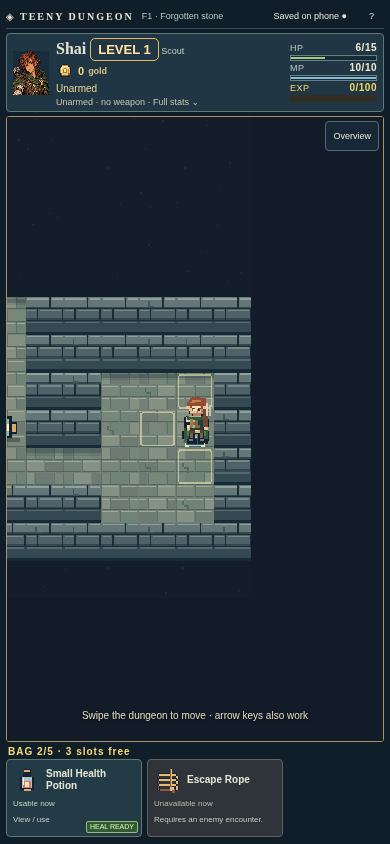
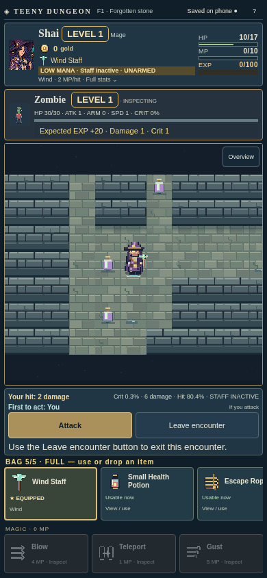
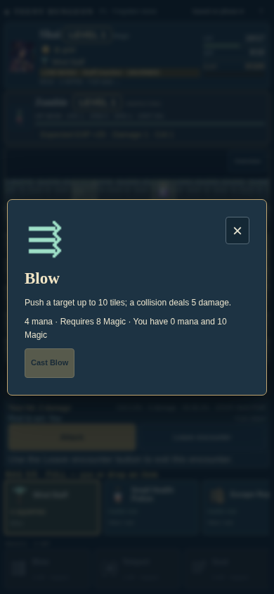
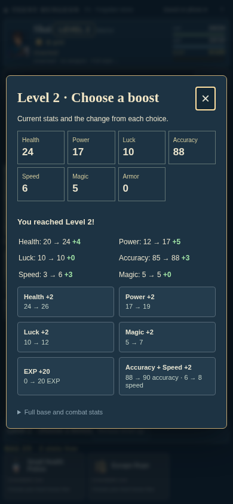
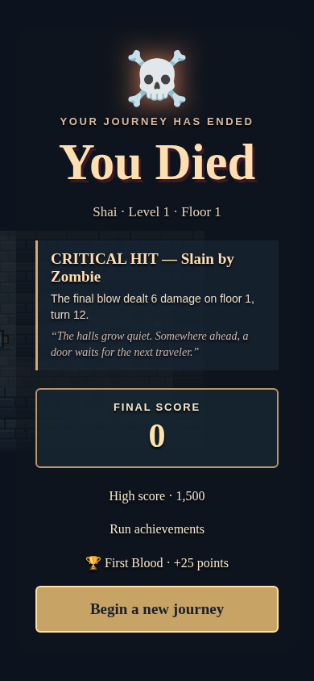

# Teeny Dungeon

**A tiny dungeon. A bag full of possibilities. One more floor.**

Explore a shifting dungeon, outsmart its creatures, and build an adventurer from the strange things you find. Play in your browser or take the offline Android edition with you. Every move is a turn, so the next decision is yours to make.

<p>
  
  
  
</p>

- **Choose your adventurer.** Warrior, Knight, Scout, or Mage, each with a different approach to survival.
- **Make every slot count.** Combine weapons, magical staves, potions, cursed bargains, and powerful carried relics.
- **Read the fight.** Inspect enemy damage, hit chances, levels, and expected experience before attacking. Learn spells before spending mana.
- **Meet the locals.** Trade with named villagers, rescue them for rewards, or face the curse that follows an innocent death.
- **Expect surprises.** Hidden rooms, treasure chests with themed rewards, traps, item-stealing gremlins, dark heroes, and roaming dragons.
- **Keep going.** Defeat Ruthagor, continue into deeper floors, earn achievements during each run, and chase a new high score.

<p>
  
  
</p>

## Play locally

Requires Node.js 24 and npm.

```sh
cd web
npm ci
npm run build
npm run preview
```

Open the URL printed by Vite (normally <http://localhost:4173>). The [web and Android guide](web/README.md) covers development, offline builds, saves, and deployment.

## Host it for free

The web edition saves adventures in each player’s browser and needs no backend or database. A GitHub Pages workflow is included. Follow the [free hosting setup guide](web/docs/STATIC-HOSTING.md) to enable it; saves can be exported and imported from the Saved adventures menu.

## Built for the small screen

Touch controls, original pixel art, readable encounters, and saved journeys make Teeny Dungeon a game you can put down and return to. Android runs the same gameplay engine locally and works offline.

The original command-line Python game is preserved in [`python/`](python/). Run `python3 game.py` from that directory to visit where the adventure began.
