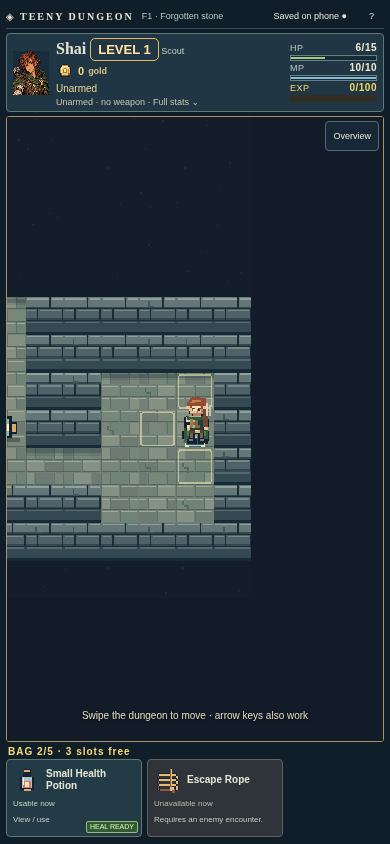
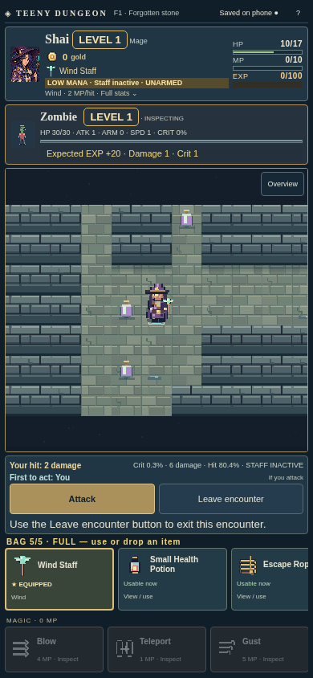
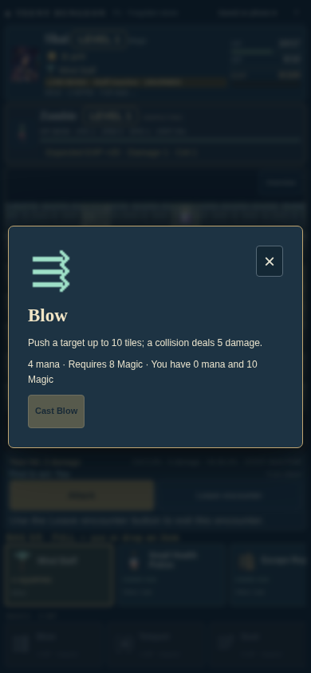
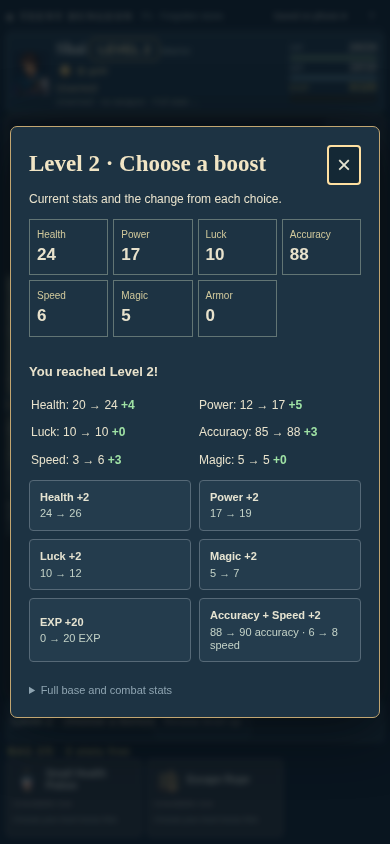
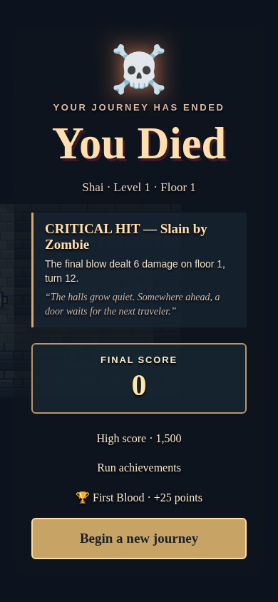

# Teeny Dungeon — web and Android

**Explore. Improvise. Survive one more floor.**

A turn-based pocket dungeon with original pixel art, four adventurer classes, collectible spells, strange relics, named villagers, hidden chambers, and endless floors beyond Ruthagor.

<p>  </p>

Build around your bag: carry a Mana Link, gamble on a mysterious item, wield an elemental staff, or hold a life-saving apple for the moment everything goes wrong. Gremlins can steal your gear; wild villagers and dark heroes can use their own. Dragons burn, ghosts cross walls, and shadows teleport.

Discover themed treasure chests, rescue villagers, upgrade equipped weapons and staves, and collect achievements that add to your score during each run. Combat shows damage forecasts, hit warnings, and expected EXP. Spell inspections explain both ready and unavailable magic.

<p> </p>

The browser runs the game locally and saves adventures in this browser on this device. Export/import backups from Saved adventures. [Host it free with GitHub Pages](docs/STATIC-HOSTING.md); no backend or database is needed. The Android edition runs the shared TypeScript rules locally and works offline. The original Python game is preserved in `../python/`.

## Run

Requires Node 24 and npm. Python 3 with NumPy is needed only for source-parity tests.

```sh
cd web
npm ci
npm run build
npm run preview
# Open the printed URL (normally http://localhost:4173)
```

For development, run `npm run dev:client` and open the printed URL. For the optional server-backed edition, use `npm run build:server && npm start`; see [server deployment](docs/DEPLOYMENT.md).

## Play

Choose Warrior, Knight, Scout, or Mage and a staff element for the Mage. The hidden `Over9000` name and `D` API class retain the original debug characters. Swipe on the map, use arrow keys, or tap an adjacent tile to move. Walk into enemies to inspect them safely, then choose Attack. Waiting is disabled; I focuses inventory, M spells, S expands stats, H opens help, and V your saved journey. Every successful action is saved locally before it is reported as successful.

Defeat the guardian on each floor to reach the stairs. Floor two has a key carrier and locked stairs. Ruthagor guards floor three. Winning grants 1,000 points and lets you continue to higher floors. Collect gear, items, pods, and spells, gain EXP, choose level-up bonuses, trade with chiefs, or fight them. Combat resolves one exchange per click, allowing the same between-exchange item/spell decisions without a blocking terminal loop.

Choose **Recover a saved adventure** on the start screen to see saved heroes by name and start date. The in-game **Saved adventures** button opens the same menu. Android lists adventures stored on that installation; the web version remembers adventures in the current browser. Progress is saved after every action. Export saves for a backup or import them on another browser/device. Older adventures without a recorded start date are labeled accordingly. Dead adventures remain available as tombstones. No copying or pasting codes is required.

## Verify

```sh
python3 -m pip install numpy playwright
python3 -m playwright install chromium
npm run test:python
npm test
npm run build
npm run test:browser
npm run build:android:web
npm run test:android:browser
```

The suite executes the unchanged Python methods, compares 80 Python-generated class/equipment/hit fixtures, tests 100 generated maps for connectivity and spawn uniqueness, covers the campaign, items, spells, NPCs, server save recovery, stale-write rejection, and actual PostgreSQL SQL through PGlite. The browser smoke test starts an isolated production server, creates a Mage, casts a spell, uses keyboard and touch controls, reloads the save, switches between named adventures and verifies that another browser has an empty private save list, and checks mobile overflow and browser exceptions. It uses system Chromium when available or Playwright's installed Chromium. `CHROMIUM_PATH` overrides the executable.

`npm run simulate` runs reproducible bot games and edge probes. See [simulation findings and fixed bugs](docs/SIMULATION.md) for the 840-game report, limitations, and stress-run commands.

GitHub Actions runs these checks on pushes and PRs. `npm run build` typechecks and compiles the static browser edition. `npm run build:server` also bundles the optional backend. See [source review and compatibility notes](docs/PORTING.md) for formula details and intentional fixes.

See the [complete v0.6 feature checklist](docs/FEATURES-V0.6.md) for the swipe interface, equipment comparisons, original animated class sprites, combat forecasts, themed floors, poison/mana warnings and direct ground actions.

## Android phone testing

A directly installable, offline Android test APK is available in [downloads](downloads/README.md). It includes the complete game and original art, with phone-sized touch controls and persistent device saves. Android progress is separate from the web version’s server saves. See [Android installation/build instructions](docs/ANDROID.md) for the download, Android 8+ requirement, verification, and save/signing limitations.

## Deployment

[Render deployment instructions](docs/DEPLOYMENT.md) include every remaining step, environment variables, database migration behavior, backup/recovery, and exact push/PR commands. `web/render.yaml` provisions a Node service and PostgreSQL database; use that path when creating the Blueprint. No live Render deployment is claimed by this checkout.

## Art

All sprites, portraits, tiles, and effects are original designs authored for this port. No Fire Emblem graphics, fonts, music, or extracted assets are included. The direction uses a restrained handheld-era palette and hard-edged pixels. Sprite source is `src/art.ts`; the renderer draws dungeon tiles and combat slash/spark animations in `src/DungeonView.tsx`. `npx tsx scripts/export-art.ts` regenerates the standalone SVG sprite atlas and metadata in `public/assets/`. Detailed original character busts are generated artwork in `public/assets/portraits.png`, displayed through `src/Portrait.tsx`; monster portraits use the authored map sprites. The map uses 24×32 shaded units, layered masonry, torch animation, and a player-following camera. The application has no external image/font/CDN dependency.

## Storage and architecture

- `shared/engine.ts`: deterministic, serializable state transitions; only the server runs authoritative actions.
- `shared/catalog.ts`: class bases, monster growth, items, and spell definitions.
- `server/app.ts`: same-origin JSON API, bearer/cookie save access, rate limiting, serialized local writes, revision conflicts, and static frontend serving.
- `server/store.ts`: PostgreSQL JSONB with compare-and-swap updates; local atomic JSON fallback.
- `migrations/001_saved_games.sql`: idempotent initial schema. Startup applies the equivalent schema before listening.
- `src/main.tsx`: desktop/mobile UI; `src/DungeonView.tsx`: Pixi renderer.

The full state, including RNG seed, floor, fog lights, entities, equipment uses, effects, XP, score, outstanding level choice, and current encounter, survives a restart. Legacy Python `.sav` files are not imported; the new save format is versioned JSON and does not deserialize executable Python objects. PostgreSQL mode supports multiple service processes without lost updates; JSON mode is for a single process with a persistent disk. Logs retain the last 100 messages. Save keys are never included in server logs.

## Teeny Dungeon expansion checks

```sh
npm test
npm run build
npm run build:android:web
python3 tests/teeny-browser.py
```

The final command checks phone interactions and regenerates the screenshots shown above. It requires Python Playwright and Chromium (`/usr/bin/chromium`).

Gameplay notes: Energy Potion restores the resource with the larger missing amount; the new Water EXP spell is called **Study**; the purple gemstone chest is **Amethyst**. New spell and item behavior is covered in `tests/teeny-expansion.test.ts`.

The current Android browser smoke suite is `tests/teeny-browser.py`: it covers the new interaction contract and five viewport sizes. Earlier version-specific browser scripts remain available for reference; they assume older spell, waiting, selling, and encounter gestures. Engine, API, persistence, art, and simulation regressions continue to run through `npm test`.
